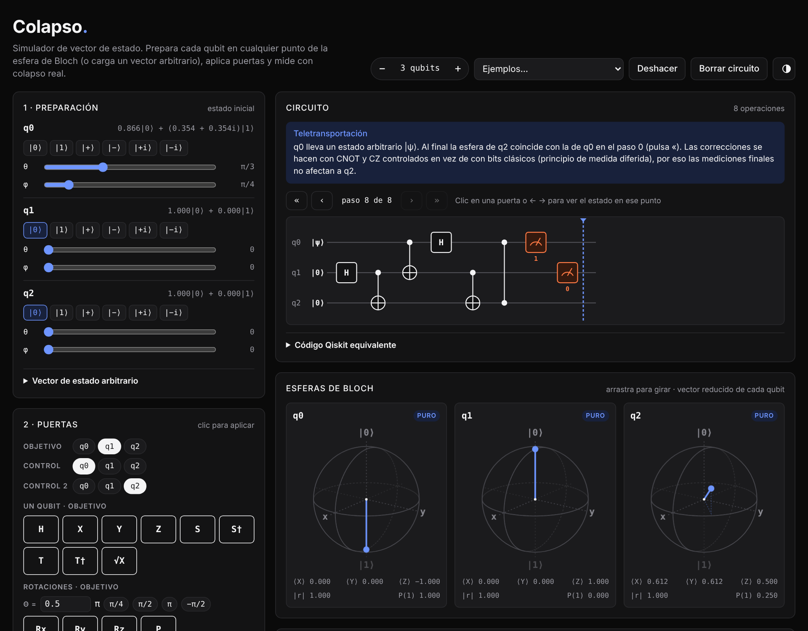

# Colapso

Simulador de circuitos cuánticos en el navegador. Preparas cada qubit en cualquier punto de la esfera de Bloch, aplicas puertas, mides (con colapso real) y ves el estado paso a paso. Es un único archivo HTML: no hay que instalar nada, no necesita servidor y no tiene dependencias.

**Pruébalo:** `https://mateogajic.github.io/colapso/`

## Qué hace

- **Preparación**
  - De 1 a 5 qubits.
  - Cada qubit se fija con presets (|0⟩, |1⟩, |±⟩, |±i⟩) o con los deslizadores θ y φ.
  - También se puede introducir un vector de estado arbitrario. Admite expresiones como `1/√2`, `i*exp(i*pi/4)` o `1e-3` y se normaliza solo.
- **Puertas**
  - De un qubit: H, X, Y, Z, S, S†, T, T†, √X.
  - Rotaciones Rx, Ry, Rz y fase P(θ).
  - De varios qubits: CNOT, CZ, SWAP y Toffoli.
- **Medición**
  - De un qubit en base Z, X o Y, con colapso del estado.
  - De todos los qubits a la vez en base Z.
  - Muestreo de N *shots* sin colapsar, para comparar frecuencias con |cᵢ|².
- **Visualización**
  - Diagrama del circuito.
  - Una esfera de Bloch por qubit, con su estado reducido. Si |r| < 1, el qubit está entrelazado.
  - Tabla de amplitudes con la fase de cada componente.
  - Estado en notación de Dirac.
- **Paso a paso**: haz clic en cualquier puerta del circuito, o usa las flechas ← →, para ver el estado en ese punto. Si añades una puerta estando en un paso intermedio, se inserta ahí.
- **Ejemplos incluidos**: estado de Bell, GHZ, interferómetro Mach–Zehnder, algoritmo de Deutsch, teletransportación y Grover de 2 qubits. Cada uno trae una breve explicación.
- **Tema claro y oscuro**: sigue el del sistema por defecto y se puede cambiar con el botón de la esquina.
- **Exportar a Qiskit**: genera el código Python equivalente. He comprobado que reproduce el mismo vector de estado.

## Convenciones

- **Orden de los qubits**: q0 es el bit de la izquierda en los kets. En |01⟩, q0 = 0 y q1 = 1, como en la mayoría de libros de texto.
  - Qiskit usa el orden contrario. El código exportado lo recuerda en un comentario.
- **Estado inicial** de cada qubit: cos(θ/2)|0⟩ + e^{iφ} sin(θ/2)|1⟩.
- **Rotaciones**: R_a(θ) = exp(−iθσ_a/2).
- **Deshacer** vuelve a ejecutar el circuito conservando los resultados de las mediciones anteriores, para que el estado no cambie al azar al quitar una puerta.
- **Teletransportación** usa el principio de medida diferida: las correcciones clásicas se sustituyen por puertas controladas.

## Usarlo en local

Descarga `index.html` y ábrelo en cualquier navegador moderno. Las fuentes se cargan desde Google Fonts. Sin conexión se usan las fuentes del sistema y todo lo demás sigue funcionando.

## Publicarlo con GitHub Pages

1. Sube los archivos a un repositorio, por ejemplo `colapso`.
2. Entra en **Settings → Pages**.
3. En *Source*, elige **Deploy from a branch**, después la rama `main` y la carpeta `/ (root)`. Guarda.
4. En un minuto estará en `https://<tu-usuario>.github.io/colapso/`.

## Cómo funciona

El simulador guarda el vector de estado completo: 2ⁿ amplitudes complejas en dos `Float64Array`, una para las partes reales y otra para las imaginarias.

- Cada puerta de un qubit (controlada o no) se aplica como una matriz 2×2 sobre los pares de amplitudes cuyo índice solo difiere en el bit de ese qubit.
- Una medición calcula la probabilidad de cada resultado, elimina las componentes incompatibles y renormaliza.
- Para medir en base X o Y, el estado se rota a la base Z, se mide y se deshace la rotación.
- El vector de Bloch de cada qubit sale de su matriz densidad reducida (traza parcial sobre el resto).

## Licencia

MIT. Consulta [LICENSE](LICENSE).
