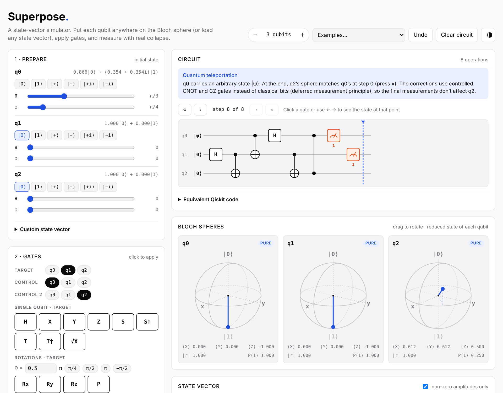

# Superpose

**An interactive qubit simulator that runs in your browser.** Put qubits anywhere on the Bloch sphere, apply gates, measure them, and watch the state collapse. Then step back through the circuit to see exactly what each gate did.

<picture>
  <source media="(prefers-color-scheme: dark)" srcset="docs/screenshot-dark.png">
  
</picture>

Superpose is a single HTML file with no installs, accounts or build step. Open `index.html` and start experimenting.

## Features

### Prepare any state
- Work with **1 to 5 qubits**.
- Set each qubit with one click (|0⟩, |1⟩, |+⟩, |−⟩, |+i⟩, |−i⟩), or move the **θ and φ sliders** to any point on the Bloch sphere.
- Load a **custom state vector**, entangled states included. Amplitudes accept expressions like `1/√2`, `i*exp(i*pi/4)` or `1e-3`, and the vector is normalized for you.

### Apply gates
| Type | Gates |
|---|---|
| Single qubit | H, X, Y, Z, S, S†, T, T†, √X |
| Rotations | Rx(θ), Ry(θ), Rz(θ), P(θ) |
| Multi-qubit | CNOT, CZ, SWAP, Toffoli (CCX) |

### Measure
- **Measure one qubit** in the Z, X or Y basis. The state collapses and the circuit carries on from there, so you can see what a measurement does to the other qubits.
- **Measure all qubits** in the Z basis.
- **Sample shots without collapsing** to compare measured frequencies with the theoretical probabilities |cᵢ|².

### See what's going on
- **A Bloch sphere for every qubit** showing its reduced state. When a qubit becomes entangled, its arrow shrinks inside the sphere and it is labelled *entangled*. You can drag the spheres to rotate them.
- **The full state vector**: a table of amplitudes, probabilities and phases, plus the state written in Dirac notation.
- **A live circuit diagram.**

### Step through the circuit
Click any gate, or use the **← →** keys, to see the state at that point. A gate added while you're on an earlier step is inserted at that step.

### Built-in examples
Each example loads a ready-made circuit with a short explanation:

- **Bell state**: entanglement from one H and one CNOT.
- **GHZ state**: three-qubit entanglement.
- **Mach–Zehnder interferometer**: single-photon interference.
- **Deutsch algorithm**: tells a constant function from a balanced one with a single query.
- **Quantum teleportation**: moves an arbitrary state from q0 to q2.
- **Grover search**: finds the marked item among four in one iteration.

### Export to Qiskit
Any circuit can be copied as equivalent [Qiskit](https://www.ibm.com/quantum/qiskit) code to run in Python or take to IBM Quantum hardware. The exported code reproduces the simulator's state vector exactly.

### Light and dark themes
The theme follows your system setting by default. You can switch it with the button in the top-right corner.

## Getting started

1. Download `index.html` (or clone this repository).
2. Open it in any modern browser.

It works offline. Without a connection it falls back to system fonts.

## Conventions

- **Qubit order**: q0 is the leftmost bit in kets. In |01⟩, q0 = 0 and q1 = 1, which is the usual textbook convention.
  - Qiskit uses the opposite order. The exported code includes a comment reminding you of this.
- **Single-qubit states**: cos(θ/2)|0⟩ + e^{iφ} sin(θ/2)|1⟩.
- **Rotations**: R_a(θ) = exp(−iθσ_a/2).
- **Undo** keeps the outcomes of earlier measurements, so removing a gate doesn't reshuffle random results.
- **Teleportation** uses the deferred measurement principle: the classical corrections are replaced by controlled gates.

## How it works

Superpose is an exact state-vector simulator. It stores all 2ⁿ complex amplitudes.

- **Gates**: every gate is applied as a 2×2 matrix (controlled where needed) to the pairs of amplitudes that differ only in the target qubit's bit.
- **Measurement**:
  1. Compute the probability of each outcome.
  2. Pick one at random.
  3. Discard the incompatible components and renormalize.
  - For X- and Y-basis measurements, the state is rotated into the Z basis first and rotated back afterwards.
- **Bloch vectors**: each qubit's vector comes from its reduced density matrix, obtained by a partial trace over the other qubits.

## License

Superpose is released under the [PolyForm Noncommercial License 1.0.0](LICENSE.md).

- **Free for any noncommercial use**: personal projects, study, teaching, research, and use by schools, universities and nonprofit organizations. You can use, copy, modify and share it, as long as you keep the license and the copyright notice.
- **Commercial use is not included.** If you'd like to use Superpose in a commercial product or service, please get in touch about a commercial license.
